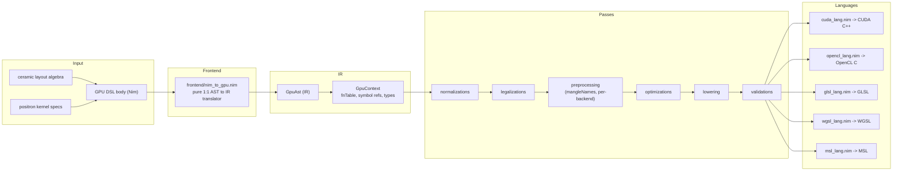

# Crucible Architecture

Crucible is the GPU code generator in the tattletale monorepo.
This document describes how a GPU DSL body written in Nim becomes native GPU source,
the pass pipeline that transforms it, and how to extend it.

## Position in the stack

Crucible is the base layer of the tattletale GPU stack.
[`workspace/ceramic/`](../ceramic/) and [`workspace/positron/`](../positron/) are built on top of it.
It hands native GPU source to the external toolchains that run it:

- **Produces** native GPU source strings handed to external toolchains:
  NVRTC (CUDA C++ → PTX), glslangValidator (GLSL → SPIR-V), the OpenCL ICD (OpenCL C → device binaries),
  wgpu-native (WGSL ingested directly), and the Objective-C runtime (`compileLibrary`, MSL → metallib).

Crucible itself is a compiler pipeline, not a runtime.

## Naming model

Languages, runtimes, and bindings are named separately:

| Layer | Names | Role |
| --- | --- | --- |
| Languages | MSL, GLSL, WGSL, OpenCL C, CUDA C++ | what the printers emit |
| Runtimes | Metal, OpenCL, Vulkan, WebGPU, CUDA | what executes the artifact |
| Bindings | objc_abi, opencl_abi, vulkan_abi, nvidia_abi | raw C FFI under the runtimes |
| Implementations | wgpu-native (in `vendor/`) | the concrete library behind a standard |

## Module layering

One import: `import workspace/crucible`.

```
crucible.nim                     Top-level API: re-exports the curated surface and
                                 the GPU builtins, catalogue in the header.
src/
  crucible_public_api.nim        Curated surface: engines, device memory, launch
                                 sugar, codegen macros. No builtins.
  crucible_gpu_builtins.nim      The builtin vocabulary callable from kernel
                                 bodies: scalar types, thread geometry, sync,
                                 math, warp reductions, atomics, pragmas.
  crucible_internal_compiler.nim The IR/compiler internals, the test surface for
                                 tests/ir.
```

## Pipeline

The compiler is a linear pipeline: a frontend lowers Nim AST to a backend-neutral IR,
named passes transform it, and per-language printers emit the result.



All five backends share the same IR and the same common pass set, registered by
`registerCommonPasses` in [`src/codegen/gpu_compiler.nim`](src/codegen/gpu_compiler.nim).
They diverge only in the per-language passes:

- `passes_cuda.nim`, `passes_glsl.nim`, `passes_msl.nim`, `passes_opencl.nim`, `passes_wgsl.nim`

Each printer emits its target language.

## Annotated tree

```
crucible.nim                        Top-level API (see Module layering).
src/
  crucible_public_api.nim           Curated surface.
  crucible_gpu_builtins.nim         Builtin vocabulary hub.
  crucible_internal_compiler.nim    IR/compiler test surface.
  macros/ast_rebuilder.nim          Nim AST rebuilding helpers.
  builtins/
    builtins.nim                  Aggregator for the builtin vocabulary.
    builtins_catalog.nim          Canonical thread geometry and the
                                  per-backend idiom matrix, barriers.
    builtins_functions.nim        Scalar math builtins (exp2, rsqrt).
    builtins_gpu_types.nim        float16, bfloat16, fp8e4m3, fp8e5m2 and
                                  their conversion primitives.
    builtins_warp_sync_reductions.nim  reduceAdd, reduceMax.
    builtins_atomics.nim          atomicFetchAdd.
    builtins_pragmas.nim          global, workgroup, device, smem, ...
    builtins_compilermagic.nim    CompileTarget, ccGetBackend.
  codegen/
    gpu_compiler.nim                Entry point. The `cuda:`/`opencl:`/`vulkan:`/
                                    `webgpu:`/`metal:` macros build a GpuContext +
                                    PassRegistry, run the passes, and call the
                                    backend codegen macro. `toGpuAst` emits the IR
                                    without running passes.
    frontend/
      nim_to_gpu.nim                Frontend: walks the typed Nim AST, emits
                                    GpuAst 1:1. Pure translator, no semantic
                                    rewriting.
      nim_to_gpu_type_resolvers.nim Type and overload resolution during IR
                                    construction.
    ir/
      gpu_ast_datatypes.nim         IR core: GpuAst node kinds, GpuType,
                                    GpuContext (unified fnTable, symbols with
                                    immutable iSym fingerprint), BackendKind,
                                    NamePolicy, base58 encoder.
      gpu_ast_type_resolvers.nim    IR type helpers (pointee kinds, type
                                    traversal).
      gpu_type_constructors.nim     GpuType constructors and helpers.
    passes/
      pass_datatypes.nim            GpuPass, PassKind, PassPhase, PassRegistry;
                                    `walk` traversal; `runPasses` (checks
                                    dependsOn).
      pass_registry.nim             PassRegistry.new().
      passes_normalizations.nim     lowerIfExpr, mapOperators, patchBoolToI32,
                                    deEmbedForRangeAdjustment, ...
      passes_legalizations.nim      Legalization transforms (result insertion,
                                    distinct resolve, byref params).
      passes_preprocessing.nim      rewriteIndexDeref, decomposeMemcpyVars,
                                    annotateTypesForCodegen, mangleNames,
                                    WGSL/bool-global phases.
      passes_optimizations.nim      max/min folding, constant-shell elimination.
      passes_lowering.nim           gtSpan -> ptr + len, compile-time parameter
                                    pruning.
      passes_validations.nim        Pre/post validation (e.g. warnUnassigned).
      passes_cuda.nim               Per-language passes: reserved words,
      passes_glsl.nim               pointer rules, subgroup emission, SSBO /
      passes_msl.nim                push-constant lowering, address spaces.
      passes_opencl.nim
      passes_wgsl.nim
    targets/
      targets_lang.nim              Dispatches codegen to the printers.
      msl_lang.nim                  Language printers: walk the IR, emit
      glsl_lang.nim                 native text. Deliberately "dumb": they
      opencl_lang.nim               format the IR, they do not reason about it.
      wgsl_lang.nim
      cuda_lang.nim
      lang_utils.nim                Shared printer helpers.
  runtime/
    errors.nim                      failLoud: stacktrace + stderr + quit(1).
    engines/
      engines_api.nim               The HwEngine concept, the newEngine
                                    dispatch, the engines' API re-exports.
      engines_common.nim            DeviceMem, Dim3, LaunchConfig, dim3.
      cuda_api.nim                  Engine facades: the user-facing API over
      opencl_api.nim                the platform sessions below.
      vulkan_api.nim
      webgpu_api.nim
      metal_api.nim
    exec/
      cuda_runtime.nim              Platform sessions: library loading, device
      opencl_runtime.nim            discovery, source -> artifact compilation,
      vulkan_runtime.nim            buffers, raw dispatch. The engine facades
      webgpu_runtime.nim            drive these.
      metal_runtime.nim
      runtime_utils.nim
    launch/
      launch_kernel.nim             launchKernel + chevron sugar.
      launch_device_fn.nim          launchDeviceFn: typed Nim device functions
                                    with a `do:` schedule block.
      launch_serialization.nim      Host -> device argument packing.
  abis/
    c_abi.nim                       Raw C FFI bindings.
    opencl_abi.nim
    vulkan_abi.nim
    nvidia_abi.nim                  CUDA driver + NVRTC bindings.
    nvidia_paths.nim                CUDA library discovery.
    objc_abi.nim                    Objective-C runtime (Metal's host API).
```

## Data-flow walkthrough

1. **Frontend (`frontend/nim_to_gpu.nim`).** The user writes a `cuda:`, `opencl:`, `vulkan:`, `webgpu:`, or `metal:` block.
   The corresponding macro in `gpu_compiler.nim` calls `ctx.toGpuAst(typeReg, body)`.
It walks the typed Nim AST and emits a `GpuAst` 1:1, one IR node per AST construct, no semantic rewriting.
Symbols are `ref` objects carrying a stable `iSym` fingerprint (see `Symbol` in `gpu_ast_datatypes.nim`).

2. **IR construction.** The frontend populates the `GpuContext`: the unified `fnTable`, `types`,
   `globalBlocks`, and per-scope symbol tables. The `fnTable` holds all known functions keyed by `iSym`.
   Range nodes record their range kind (inclusive/exclusive) instead of encoding exclusivity with a `+1`.

3. **Pass pipeline.** `registerCommonPasses` registers, in order: pre-validation, normalization,
   type-system, legalization, preprocessing, optimization, lowering, post-validation.
   - `runPasses` (in `pass_datatypes.nim`) executes them in registration order, verifying each
     pass's `dependsOn` list was satisfied, and passes mutate the IR in place.
   - `PassKind` is `pkValidation` (check-only), `pkTransform` (mutates IR), or `pkAnalysis`
     (metadata only). `PassPhase` orders it: `phaseEarly`, `phasePreprocessing`, `phaseMain`.
   - Per-language passes are registered by the `passes_<lang>.nim` modules.

4. **Language printing (`targets/`).** Each printer exposes `preprocess` and `codegen`, `targets_lang.nim` dispatches.
   The printers walk the now-annotated IR and emit native text.

5. **Runtime path.** The compile-time macro result is a source string.
   - An engine ingests it via `engine.ingest(source)`, the platform session under `runtime/exec/`
     compiles it to an executable artifact.
   - `launchKernel` or `launchDeviceFn` dispatches it, packing arguments through
     `launch_serialization.nim`.
   - `launchDeviceFn` is the typed path: the kernel is a Nim proc, its body is lowered by the same
     frontend and pass pipeline, the `do:` schedule block sets `grid` and `blk`.

## Extension points

### Adding a pass

1. Create or extend a file under `src/codegen/passes/`.
   Implement the transform/validation as a `proc(ctx: var GpuContext): void`.
2. Register it with `reg.register("name", kind, phase, "description", run = ...)` in
   `registerCommonPasses` (`gpu_compiler.nim`) or in the per-language registration
   inside `passes_<lang>.nim`.
3. Set `dependsOn` to any passes it requires, `runPasses` enforces the dependency.
4. Add an IR-level test under `tests/ir/` and, if it affects output, per-backend tests under `tests/codegen/<backend>/`.

### Adding a backend

1. Add a printer file under `src/codegen/targets/` exposing `preprocess` and `codegen`.
2. Wire it into `targets_lang.nim` and add the `codegen<Backend>` macro in `gpu_compiler.nim`.
3. Add the platform session under `src/runtime/exec/`, the engine facade under `src/runtime/engines/`,
   the raw bindings under `src/abis/`, and the `BackendKind` value in `gpu_ast_datatypes.nim`.
4. Add a `tests/codegen/<backend>/` suite obeying the naming convention of [`AGENTS.md`](AGENTS.md).
   Backends that cannot auto-run get a `manual_*` test.

## Related docs

- [`README.md`](README.md): capability proof, status, source layout, run commands.
- [`AGENTS.md`](AGENTS.md): test conventions and run commands.
- [`workspace/ceramic/`](../ceramic/) and [`workspace/positron/`](../positron/): inputs consumed by Crucible.
