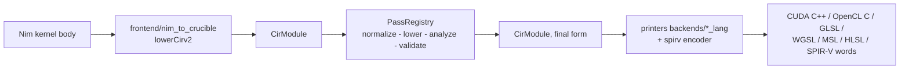

# Crucible Architecture

Crucible is the GPU code generator of the tattletale monorepo.
A kernel body written in Nim becomes native GPU source, or binary SPIR-V, at compile time.
The route is one intermediate representation, CIRv2, one pass pipeline, and one printer per target.
Crucible is a compiler, not a runtime.

## Position in the stack

Crucible is the base layer of the GPU stack.
[`workspace/ceramic/`](../ceramic/) and [`workspace/positron/`](../positron/) build on it.
The codegen macros produce their output during Nim semantic analysis.
The external toolchains consume it:

| Toolchain           | Input    | Output            |
| ---                 | ---      | ---               |
| NVRTC               | CUDA C++ | PTX               |
| glslangValidator    | GLSL     | SPIR-V            |
| dxc                 | HLSL     | SPIR-V            |
| OpenCL ICD          | OpenCL C | device binaries   |
| wgpu-native         | WGSL     | ingested directly |
| Objective-C runtime | MSL      | metallib          |

## Module layering

One import: `import workspace/crucible`.

| Module                               | Role                                                               |
| ---                                  | ---                                                                |
| `crucible.nim`                       | Top-level API, re-exports the curated surface and the GPU builtins |
| `src/crucible_public_api.nim`        | Engines, device memory, launch sugar, codegen macros, no builtins  |
| `src/crucible_gpu_builtins.nim`      | Builtin vocabulary callable from kernel bodies                     |
| `src/crucible_internal_compiler.nim` | Test surface for `tests/ir/`, re-exports the compiler internals    |

## CIRv2, the intermediate representation

`src/codegen/ir/cirv2_lang.nim` defines CIRv2: a plain Nim object-variant tree, usable at macro time, shaped as a Final IR.
The shape rules:

| Rule            | Form                                                                                       |
| ---             | ---                                                                                        |
| Control flow    | Statement-based: `sIte`, `sLoop`, `sCase`, `sScope`                                        |
| Calls           | `eCall` is an ordinary value node in any operand position, statement calls stay `sCall`    |
| Typing          | Every typed operation states its type, the `(add Type a b)` discipline of the Leng grammar |
| Inline assembly | First-class: `sAsm`, and `{.emit.}` lowers to the same shape as `sEmit`                    |

The tree composes five node families:

| Node        | Contents                                                                                             |
| ---         | ---                                                                                                  |
| `CirModule` | Nominal type declarations, the proc set, program-scope declarations, the analysis records            |
| `CirProc`   | One proc or kernel: name, typed params, return type, statement body, kernel and linkage flags        |
| `CirStmt`   | Statement vocabulary, Leng names                                                                     |
| `CirExpr`   | Expression vocabulary, Leng names, every typed operand states its type                               |
| `CirType`   | Closed kind set: scalars by bit width, vectors, pointers, nominal structs, arrays, spans, proc types |

Pointer types and span types name their memory class through `AddressSpace`:
`caThread` names per-thread registers and is the unannotated default, `caThreadgroup`, `caConstant`, and `caDevice` name the shared classes.
The frontend derives a value's class once at the boundary, passes never re-derive it.

Type identity has two comparison contracts:

- `sameType`: nominal structs compare by name, every other kind compares field by field, recursively
- structural identity in `resolveStructType`: a struct registers once per field list,
  first registration wins, so two type texts reaching one structure share one
  registered struct and one name

`src/codegen/ir/cirv2_build.nim` supplies the constructors.
`src/codegen/ir/cirv2_pretty.nim` renders the tree as an s-expression dump for tests and pass development.

`src/codegen/ir/ast_datatypes.nim` keeps the small cross-boundary vocabulary.
`BackendKind` names the runtime engines, `GpuTypeKind` enumerates the builtin scalar and vector types.
`GpuContext` is the compilation state handed to a printer, its `module` field is the CIRv2 module after the pass registry.

## Pipeline

Each target exposes one untyped macro: `cuda:`, `opencl:`, `glsl:`, `webgpu:`, `metal:`, `hlsl:`, `spirv:`.
The macro in [`src/codegen/gpu_compiler.nim`](src/codegen/gpu_compiler.nim) records the compile target.
It delegates to a typed macro that runs four steps:

1. `lowerCirv2` lowers the typed body to a `CirModule`, a refusal becomes a compile-time error
2. `buildPipeline` materializes the target's pipeline from the table in `gpu_compiler.nim`, one ordered column per target
3. `runPasses` executes the registry in that order, a refusal becomes a compile-time error
4. `backends_api.codegen` prints the module with the target's printer, `spirv` encodes binary words instead

### Stages

Every target registers the first three stages in the same order:
statement-expression rewriting, value normalizations, the reshaping passes.
Divergence starts at the reserved-word rename.

| Stage           | Registration                        | Passes                                                                                         |
| ---             | ---                                 | ---                                                                                            |
| Legalization    | `registerRewriteStmtsExprs`                 | `rewriteStmtsExprs`, rewrites statement-expressions into statement position, in front of the statement reading the value or inside the branch computing it |
| Value normalization | `registerValueNormalizations`   | `resolveBoolDomain`, the bool operator domain; `typeLiterals`, literal use-site types; `completeConstructors`, constructor field order and zero fill |
| Reshaping       | `registerReshapingPasses`           | `bindCompoundAssignTemps`, binds compound-assignment targets that contain calls into temps |
| Shared lowering | `registerSharedLoweringPasses`      | `lowerSpans`, splits `openArray` spans into pointer + length pairs                             |
| Reserved rename | one table row per text target       | `registerRenameReservedIdentifiers` with the target's reserved-word set as data                |
| Target lowering | one table row per pass              | the target's storage-model transforms, table below                                             |
| Analysis        | one table row per pass              | the target's feature scan, struct layouts, call graph, or binding records                      |
| Validation      | `registerValidationPostPasses`      | `validateAddressSpaceCasts`, `validateConstantWrites`, check-only, every column runs them last |

### Pass records

`src/codegen/passes/pass_datatypes.nim` defines the machinery:

| Record      | Contract                                                                                                                         |
| ---         | ---                                                                                                                              |
| `PassKind`  | `pkValidation` refuses on invariant violation, `pkTransform` rewrites the IR, `pkAnalysis` computes metadata and changes nothing |
| `CirPass`   | Name, kind, description, `run` over the module                                                                                   |
| `runPasses` | Executes the registry in registration order, refuses a `pkTransform` registered after a `pkAnalysis`, returns the first refusal, runs `verifyModule` once at the final pass boundary (after the last transform, or after the last pass when the registry has none) when the module sets `verifyIR` |

The table in `gpu_compiler.nim` is the single source of execution order:
one ordered column per target, row position is execution position, no scheduler.
A pass run takes the module in place and returns its refusal: `""` when clean, else the first refusal.
The refusal channel is pure strings, no exceptions cross the pipeline.

### Target lowering and analysis

| Target | Lowering passes                                                                                                                                                                                                                                       | Analysis passes                                                                                             |
| ---    | ---                                                                                                                                                                                                                                                   | ---                                                                                                         |
| CUDA   | `decomposeArrayAssign`, the reserved-word rename, address-space callee instantiation                                                                                                                                                                  | `cudaScanModuleFeatures`, the warp-reduction kinds the printer templates emit                               |
| MSL    | `decomposeArrayAssign`, `explodeKernelStructs`, const_mem hoist to program scope, device-fn smem hoist to reference parameters, kernel smem locals kept in-body, coordinate builtins threaded to device functions, address-space callee instantiation | none, the MSL printer reads no analysis record                                                              |
| OpenCL | `decomposeArrayAssign`, `explodeKernelStructs`, const_mem hoist, by-value struct parameters as hidden thread pointers, address-space callee instantiation                                                                                             | `openclScanModuleFeatures`                                                                                  |
| GLSL   | `glslQualifyVarParams` (var parameters retype to their pointee), pointer-local dissolution, program-scope hoist of smem and const_mem, address-space callee instantiation                                                                             | ref-block registration, `glslScanModuleFeatures`, `glslComputeStructLayouts` (std430)                       |
| WGSL   | struct-argument explosion, pointer-local dissolution, bool kernel-parameter reads rewritten to `!= 0u` comparisons, program-scope hoist, address-space callee instantiation, pointer-param call inlining                                              | struct-reference set, `wgslScanModuleFeatures` (`enable f16`), `wgslComputeStructLayouts` (launch ABI)      |
| HLSL   | `hlslMaterializeNumWorkgroups`, pointer-local dissolution, the reserved-word rename, const_mem hoist, address-space callee instantiation                                                                                                              | `hlslClassifyParams` (per flavor), struct-reference set, `hlslCallGraphAnalysis` with the recursion refusal |
| SPIR-V | `spirvPatchBoolToI32`, bool kernel parameters and bool globals retype to i32 storage                                                                                                                                                                  | none                                                                                                        |

Notes on the shared passes:

- `explodeKernelStructs` expands kernel parameters of struct type with pointer fields into flat leaves
  One buffer binds per leaf on the flat-resource targets: Metal, WebGPU, OpenCL
- `decomposeArrayAssign` rewrites whole-array assignment into `__builtin_memcpy` calls
  No C-family target expresses an array copy
- the reserved-word rename suffixes `_nim` at every emitted site
  WGSL additionally prefixes every `__`-headed name with `wgsl_`
- `instantiateAddressSpaceGenerics` specializes module callees whose pointer arguments name another address space than the formal
  One variant prints per space, every text target except SPIR-V registers the pass

CUDA registers no pipeline pass of its own, its storage model lives around the table:

- the frontend materializes every `var T` call argument as an address-of over the lvalue
  Nim sem rejects a computed value for a `var T` parameter before anything reaches CIRv2
- by-value array parameters decay to `const T name[]` at the printer
- the printer owns the warp-reduce templates, the braced init lists, the coordinate arithmetic
  It also owns the qualifier set, kernel linkage, and the barrier and atomic names

## Analysis-last invariant

The pass registry has no invalidation: a pass runs once, in registration order.
A result stays valid only while no transform runs after it.

Each target registers its analysis passes (`pkAnalysis`) after its last transform and before the check-only validation stage.
The printer reads the stored records from `CirModule` and never rescans:
`features`, `layouts`, `callGraph`, `structRefs`, `paramClasses`, `refBlocks`.

`runPasses` refuses a transform registered after an analysis.
The analysis-last placement itself is the table's column shape in `gpu_compiler.nim`, analysis rows close every column that has them.

## Printers

Six text printers live in `src/codegen/backends/`: `cuda_lang`, `opencl_lang`, `glsl_lang`, `wgsl_lang`, `msl_lang`, `hlsl_lang`.
The SPIR-V encoder (`spirv_shader_lang`) sits beside them.
The printers walk the final module and emit text, they do not reason about semantics.
A printer refusal is a compile-time error naming the construct.

Two shared layers keep the printers thin:

- `print_common.nim`: the statement and expression walk, a C declarator engine, literal tokens, loop text
- `targets_registry.nim` and `targets_rows.nim`: the printers' static rows as plain per-target constants

`backends_api.nim` dispatches `codegen` on a static `Backend` value.
The compiler folds the dispatch to a direct call.
`Backend` names the text printers, `BackendKind` names the runtime engines.
The two enums stay separate.

## Frontend

`src/codegen/frontend/nim_to_crucible.nim` lowers the typed macro body to CIRv2, one Nim node in, one IR node out.
`nim_type_resolvers.nim` resolves types and overloads during IR construction.

Procs intern through the frontend's proc registry: one entry per proc identity.
The emitted name is claimed at first registration, a second claimant of a base name suffixes.
A construct outside the supported closure refuses through the refusal channel.
The macro turns that refusal into a compile-time `error` naming the construct.

## Runtime

The compile-time macro result is a source string or SPIR-V words.
The runtime layer turns it into an executing kernel:

| Layer             | Files                    | Role                                                                                                    |
| ---               | ---                      | ---                                                                                                     |
| Engine facades    | `src/runtime/engines/`   | `newEngine`, `ingest`, device memory, the user-facing API per backend                                   |
| Platform sessions | `src/runtime/backends/`  | Library loading, device discovery, source to artifact compilation, raw dispatch                         |
| Launch            | `src/runtime/launch/`    | `launchKernel` with chevron sugar, `launchDeviceFn` with a typed `do:` schedule block, argument packing |
| Bindings          | `src/abis/`              | Raw C FFI: CUDA driver + NVRTC, OpenCL, Vulkan, Objective-C                                             |
| Errors            | runtime-wide             | Runtime refusals call `raiseAssert` immediately: the stacktrace is the location record                 |

## Enforcement map

| Invariant                                                       | Enforcement                                                                                                       |
| ---                                                             | ---                                                                                                               |
| Registration order is execution order                           | `runPasses` iterates the registry in registration order, there is no scheduler                                    |
| A transform never runs after an analysis                        | `runPasses` refuses when a `pkTransform` follows a `pkAnalysis`                                                    |
| Pass-boundary scope closure and emitted-name uniqueness         | `verifyModule` via `runPasses`, gated on the module's `verifyIR` field, which `-d:CIR_verify` defaults            |
| A refusal anywhere is a compile-time error naming the construct | The macros call `error()` on frontend and pipeline refusals, `codegenModule` calls `error()` on a printer refusal |
| An analysis result survives only with no transform after it     | The registration sequence in `gpu_compiler.nim`, the registry has no invalidation                                 |
| Target static data is complete and consistent                   | The `checkScalarRow`/`checkScalarRowsTogether` static block in `targets_rows.nim`; a missing entry is a compile error at the printer's lookup site |
| The passes layer exports only `register*` procs                 | The `passes-export` linter rule                                                                                   |

## Refusals and testing

Refusals flow end to end as strings, no exceptions cross the pipeline:

| Stage    | Refusal path                                                                   |
| ---      | ---                                                                            |
| Frontend | `lowerCirv2` returns the first refusal, the macro raises it as a compile error |
| Passes   | `runPasses` returns the first pass refusal, the macro raises it                |
| Printer  | The walk records the first refusal, `codegenModule` raises it                  |

No negative-compile test runs automatically, an expected compile failure is a `manual_` file run by hand.
Pass-level checks run through a `PassRegistry` on a module built by the same
builders the frontend uses, inside a kernel test through the public API.

A compiler change answers behavioral checks, never byte identity:

- kernels launch and read back the expected results
- compile time stays close to the recorded measurements
- runtime performance is unchanged
- the maintenance line count goes down

Every test launches through `engine.launchKernel()` or `engine.launchDeviceFn()`, ingestion alone is not a test.
[`AGENTS.md`](AGENTS.md) documents the test conventions and run commands.

## Extension points

### Adding a pass

1. Implement the transform or check over `CirModule` in a file under `src/codegen/passes/`, file-local.
2. Give it a `register*` proc with name, kind, description, and `run`.
   Implementations stay file-local, the `register*` proc is the only public surface of a passes file.
3. Add the register proc to every target's table column that runs the pass, in execution position.
4. Verify the behavior end to end: a kernel test through the public API which
   launches and reads back, plus a per-backend test when output changes.

### Adding a target

| Step | Action |
| --- | --- |
| Printer | Add a printer under `src/codegen/backends/`, import `print_common`, state the target's rows in `targets_rows.nim` |
| Dispatch | Add the `Backend` value in `backends_api.nim` and the `codegen<Target>` macro in `gpu_compiler.nim` |
| Pipeline | Add the target's ordered column to the table in `gpu_compiler.nim`: rename, lowering, analysis, and validation rows in execution position |
| Runtime | Add the platform session (`src/runtime/backends/`), the engine facade (`src/runtime/engines/`), the raw bindings (`src/abis/`), and the `BackendKind` value in `ast_datatypes.nim` |
| Tests | Add a `tests/codegen/<backend>/` suite, a target that cannot auto-run gets `manual_` files |

## Related docs

- [`README.md`](README.md): capability proof, source layout, run commands, builtin vocabulary and per-backend idiom matrix
- [`AGENTS.md`](AGENTS.md): test conventions, emitted-output policy, benchmarks
- [`workspace/ceramic/`](../ceramic/) and [`workspace/positron/`](../positron/): the inputs Crucible consumes
