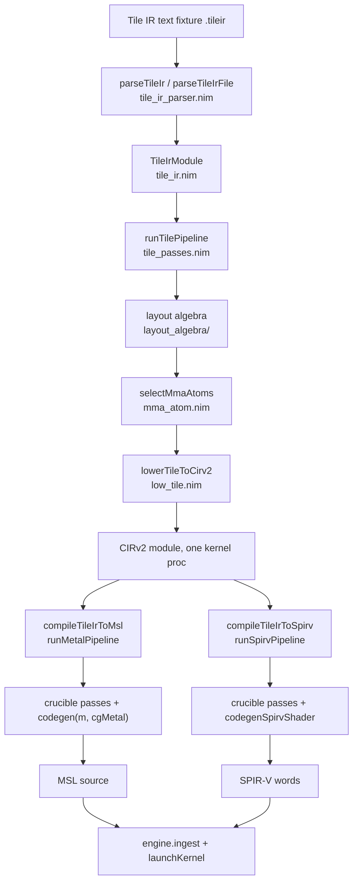

# tattletile

Tattletile compiles official NVIDIA Tile IR text into crucible's CIRv2, resolving every layout
through its own transformation-oriented layout algebra, so all crucible backends fall out free
on the same shared bridge output.

- the bridge constructs the `CirModule` directly through crucible's `cirv2_build`
  (`workspace/crucible/src/codegen/ir/cirv2_build.nim`)
- tattletile drives crucible's pass pipeline itself, the shipped backends print the artifacts

The compiler exists to prove one claim: the layout, scheduling, and atom decisions NVIDIA
hides inside its closed `tileiras` assembler can live in an open, inspectable pass layer,
built on ceramic- and crucible-grade primitives.

Pipeline at a glance:



Depth per stage: `docs/pipeline.md`. Decisions and rejected alternatives: `docs/adr/`.

Port omissions, decided:

- the python reference prototype is not ported, the reference computations run in-process
  in the suites, float64-then-narrow order
- the function-prototype BOM (`docs/bom.md` in the source tree) is not ported either,
  the doc comments on the procs are the contract

## Proven capabilities

One table entry per capability, each naming its test file and what the test proves.
Every test compiles and runs from the worktree root:

```
nim c -r --hints:off --warnings:off \
  --nimcache:nimcache/tattletile --outdir:build/tattletile \
  workspace/tattletile/tests/<test-file>
```

The whole pipeline is value-level and VM-clean, `embedKernel` const-evaluates a fixture
compile inside the binary that ships it.

| Capability | Proof | Test |
|---|---|---|
| Tile IR datatypes, subset parser, printer | parse round-trip fixed point on the hand-encoded and compiler-captured fixtures, 25 refusal cases | `tests/test_tile_ir_parse.nim`, `tests/test_tile_ir_refusals.nim`, `tests/test_tile_ir_captured.nim` |
| Tile passes | reference layouts, ownership `{t, t+4}`, program op order, token chain, refusals including the unlowered capture-only ops | `tests/test_tile_passes.nim` |
| Layout algebra | byte-exact structural dumps and ownership tables vs the python oracle, 4 checks | `tests/test_layout_algebra_conformance.nim` |
| Swizzle concretization | F2 arithmetic, the `SW3_3_3` bank-conflict-free property, functor equivalence | `tests/test_layout_swizzle.nim` |
| Mma atom layer | Apple 8x8x8 fragment layouts bit-linear over all 32 lanes, selection fallback | `tests/test_mma_atom.nim` |
| axpy end to end on Metal | bitwise-exact (int32 view) over 16 elements, 2 blocks x 4 threads | `tests/test_axpy_metal.nim` (+ `tests/test_axpy_msl.nim` golden) |
| GEMM end to end on Metal | bitwise-exact over 256 outputs, abstract FMA at 4 threads | `tests/test_gemm_metal.nim` (+ `tests/test_gemm_msl.nim` golden) |
| Hardware simdgroup mma | Apple 8x8x8 atom path at 32 threads, bitwise over 256 outputs on Metal | `tests/test_gemm_atom_metal.nim` |
| Second backend free | SPIR-V words pass `spirv-val --target-env vulkan1.4`, structure goldens | `tests/test_embed_spirv_words.nim` |
| SPIR-V on MoltenVK | both fixtures execute bitwise-exact (int32 view) on MoltenVK, Apple M4 Max | `tests/test_embed_spirv_vulkan.nim` |
| Compile-time embedding | one binary embeds both fixtures as `const`, ships no parser or runtime compiler | `tests/manual_embed_axpy_gemm.nim` (demo host, run manually) |

## Quick start

Compile-time embedding is the product entry (`src/tattletile/embed.nim`).
One `const` per kernel, Metal source or SPIR-V words, no parser in the shipped binary:

```nim
import workspace/crucible
import workspace/tattletile/tattletile

const Axpy = embedKernel("../fixtures/vec_add_axpy.tileir", "axpy", threads = 4)
const AxpySpv = embedKernel("../fixtures/vec_add_axpy.tileir", "axpy",
                            threads = 4, backendKind = gbSpirv)

var engine = newEngine(runMetal)
engine.ingest(Axpy.msl)          # or engine.ingest(AxpySpv.words) on the Vulkan engine
let aDev = engine.allocDevice(float32, N)
# ...
# slot 0 binds the output buffer, then the remaining entry arguments
var args = (int32(N), aDev, int32(N), bDev, int32(N))
engine.launchKernel(Axpy.name, cDev, args) do:
  grid = (N div 8, 1)
  blk = (4, 1)
```

The full demo host embedding both fixtures and running them on Metal is
`tests/manual_embed_axpy_gemm.nim`.

## Measured numbers

| Claim | Value | Where |
|---|---|---|
| Metal axpy | bitwise-exact (int32 view) over 16 elements, 2 blocks x 4 threads | `tests/test_axpy_metal.nim` |
| Metal gemm | bitwise-exact over 256 outputs, abstract path (4 threads) and atom path (32 threads) | `tests/test_gemm_metal.nim`, `tests/test_gemm_atom_metal.nim` |
| SPIR-V | words validate at `--target-env vulkan1.4`, MoltenVK execution bitwise-exact | `tests/test_embed_spirv_words.nim`, `tests/test_embed_spirv_vulkan.nim` |
| Layout algebra | byte-exact vs the python oracle: ownership tables, tiler promotion, composition strides, cosize | `tests/test_layout_algebra_conformance.nim` |
| Atom density | 60 scheduled ops per thread per public mmaf (32 fragment loads + 8 simdgroup mma + 8 stores + 8 accumulator inits + 4 prelude), 25 CIRv2 nodes (22 statements + 3 loops), 16x16x16 tile | `tests/test_gemm_atom_metal.nim` |

The density number is the tattletile baseline against NVIDIA's closed tileiras assembler:
on comparable shapes it schedules about half these ops per public mmaf by hoisting fragment
loads out of the repetition loops, so this unoptimized first cut costs about 2x.
The hoisting pass (fragment reload elimination) is recorded as future work.

## Scope and limits

The supported Tile IR subset is the fixture op set:

- ops: `constant`, `make_token`, `make_tensor_view`, `make_partition_view`, `get_tile_block_id`
- ops continued: `load_view_tko`, `store_view_tko`, `addf`, `mulf`, `mmaf`, `yield`
- attributes: `di_name` on entries, `padding_value = zero` on partition views
- one fused thread-value loop per kernel, static tile shapes, f32 and i32 elements, splat constants

The compiler captures add:

- `assume`, `reshape`, `broadcast`
- the `for` region with `continue`
- `return` as the entry terminator, no yielded value

`docs/captured-fixtures.md` records the compiler-emitted fixtures and this grammar.
The atom path covers one mmaf per kernel on Metal.

- Selection reads the element type and the tile dims at the launch thread count.
  The selector routes a kernel with an eligible mmaf to the atom path.
- The fragment program refuses every op beyond the operand loads, one splat constant, one mmaf and its store, such as an `addf`.
- The abstract FMA fallback covers the shapes that no atom selects.

Constructs outside the subset refuse loudly, naming the construct and the kernel:

- unsupported ops, element types and dynamic tile dims
- thread counts that do not divide a tile, broken token chains
- view disagreements: a partition tile rank unlike its tensor_view's, or a loaded or stored tile unlike its view's partition tile
- unequal-shaped or non-square mmaf operands

Verified coverage, bitwise against the python float64-then-narrow reference on Metal and Vulkan:

- axpy `tile<8>`, 4 threads
- gemm `tile<16x16>`, 4 threads and 32 threads (the atom path)

Kernels beyond the two fixtures compile under the refusals above, with numeric correctness beyond the fixtures unverified.
ADR `docs/adr/0009-crucible-untouched.md` records the boundary: zero crucible or ceramic
changes across the whole port.
