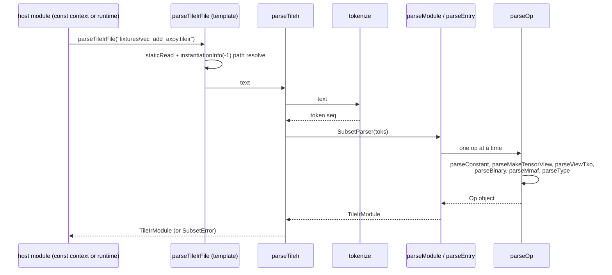
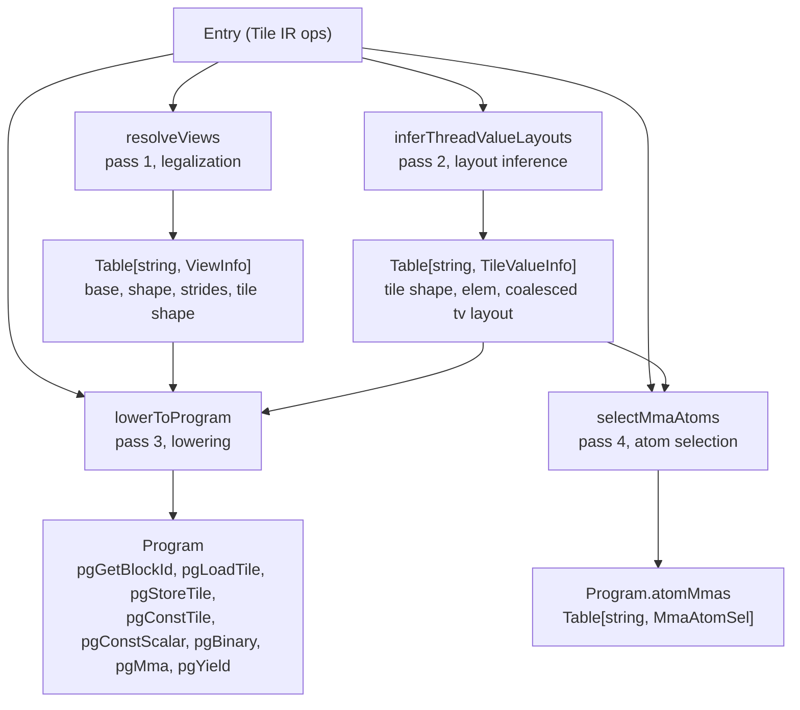
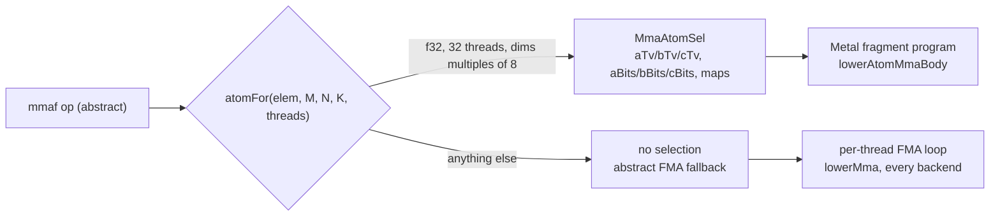
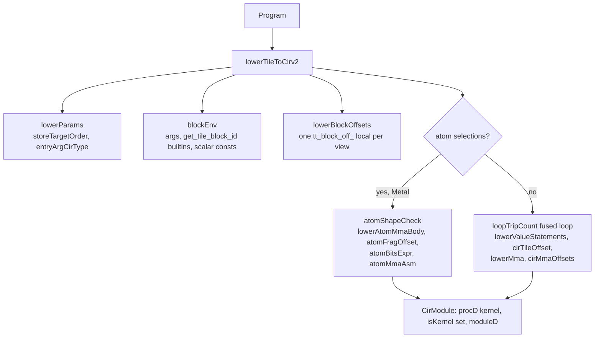
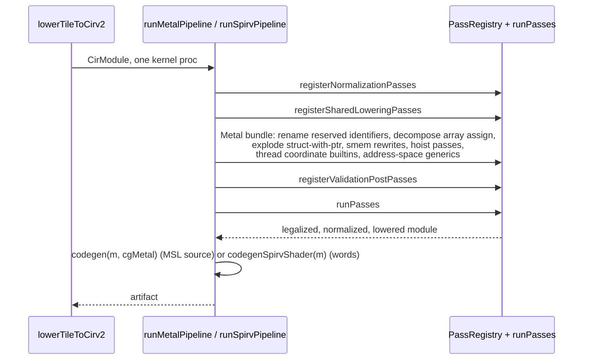
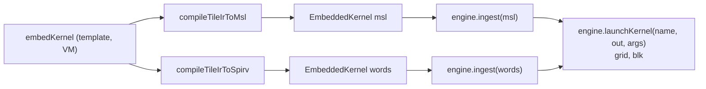

# tattletile pipeline

Tattletile turns official NVIDIA Tile IR text into per-backend artifacts in six stages.
Each stage is a small tattletile-owned module, the last two are crucible machinery.
This page walks the stages in order and names the real procs and files.

```
Tile IR text -> parse -> tile passes -> layout algebra -> atom selection
             -> CIRv2 bridge -> crucible pass pipeline -> backend artifact
```

- stages 1 to 4 are pure data transformation over value objects, runnable in the Nim VM and at runtime
- stage 5 emits a CIRv2 module with one kernel proc, built through crucible's `cirv2_build`
- stage 6 is crucible's pass pipeline: tattletile re-creates the per-target pass composition
  from `workspace/crucible/src/codegen/gpu_compiler.nim` and drives `runPasses` itself

## 1. Parse: Tile IR text to the object model

Files: `src/tattletile/tile_ir_parser.nim` (parser), `tile_ir.nim` (datatypes),
`tile_ir_printer.nim` (printer).

The parser is a hand-written tokenizer plus recursive descent over exactly the constructs
the fixtures use. Anything outside the subset raises `SubsetError`, naming the construct
and the kernel. Every op stores its parsed operand and result types, so later passes
never re-parse text.



| Proc | Role |
|---|---|
| `parseTileIrFile(path)` | template, `staticRead` at compile time, path relative to the instantiating module |
| `parseTileIr(text)` | runtime + VM parse of a string, shared core of the template |
| `tokenize(text)` | tokens: `%ssa`, `@name`, numbers, `->`, `x`, keywords, punctuation |
| `parseModule`, `parseEntry` | `cuda_tile.module @name { entry @kernel(...) { ops } }` |
| `parseOp` | dispatch to `parseConstant`, `parseMakeTensorView`, `parseViewTko`, `parseBinary`, `parseMmaf` |
| `parseType` | `token`, `tile<SxE>`, `tile<ptr<E>>`, `tensor_view<...>`, `partition_view<...>` |
| `checkArity`, `refuse`, `refuseArity` | loud refusals naming construct and kernel |
| `opSpelling(kind)` | Tile IR text form of an op, used by every downstream refusal |

The printer (`printTileIr`, `opToText`, `typeToText`, `constToText`) emits fixture-form text.
Parse-print-parse reaches a fixed point, tested in `tests/test_tile_ir_parse.nim`.
The embed suites and the demo host cover the compile-time path, every `embedKernel` call
const-evaluates the full pipeline.

## 2. Tile passes: ops to per-thread layout assignments

File: `src/tattletile/tile_passes.nim`. Entry proc `runTilePipeline(entry, threads)` runs
three named passes in TileLang-cutedsl order, then the atom selection pass.
Every pass refuses loudly on anything it cannot resolve, see each pass doc for the refusals.
The enforced subset boundary is enumerated in the README's verified-coverage list.



- `resolveViews` pairs each load/store view operand with its defining `make_partition_view` and `make_tensor_view`, keyed by view SSA name
- `inferThreadValueLayouts` assigns each tile SSA value a tile shape plus the coalesced
  thread-value layout, the shape linearized with the first dimension major
- `coalescedTv` builds it through the algebra: `makeLayout(@[threads, values], @[1, threads])`, call `tv(t, v) = t + v*threads`
- `lowerToProgram` validates the token chain, view index counts and the mmaf subset form, one `ProgramOp` per surviving op

`selectMmaAtoms` (pass 4) asks the atom layer per mmaf result, stage 4 of this page.

## 3. Layout algebra: the transformation vocabulary

Files: `src/tattletile/layout_algebra/` (`htuple`, `layout`, `algebra`, `swizzle`),
umbrella `layout_algebra.nim`. Every op is a value-level port of the frozen python
reference implementation (vendored pycute), byte-exact against it.

A `Layout` is a shape tree plus a congruent stride tree over hierarchical `IntTuple`s.
Stride leaves are `StrideScalar`: integers, or coordinate-axis basis elements
(`eUnit(@[axis])`, the pycute `E()` form).
Evaluation is `L(c) = innerProduct(idx2crd(c, shape), stride)` through `call`/`callInt`.

| Op | File | Role |
|---|---|---|
| `makeLayout`, `tilerToLayout` | `layout.nim`, `algebra.nim` | construction, tiler promotion |
| `compose`, `composeModes` | `algebra.nim` | group composition `A o B`, `R(i) = A(B(i))` |
| `zippedDivide`, `logicalDivide` | `algebra.nim` | split a layout by a tile, mode 0 tile, mode 1 rest |
| `complement` | `algebra.nim` | fill the codomain holes of a layout, colex-ordered stride walk |
| `rightInverse` | `algebra.nim` | largest injective layout with `L(R(k)) == k` |
| `coalesce`, `coalesceZ` | `algebra.nim` | merge contiguous modes, linearity-checked fold |
| `logicalProduct` | `algebra.nim` | reproduce a block over a grid, `A x B = (A, A* o B)` |
| `greatestCommonDomain`, `layoutAdd` | `algebra.nim` | coordinate-wise addition over a common refinement |
| `size`, `cosize`, `rank`, `modes`, `getMode` | `layout.nim` | analysis |
| `f2Add`, `f2Mul`, `initSwizzle`, `apply`, `swizzleLayout` | `swizzle.nim` | F2 arithmetic, `SW_<bits>_<base>_<shift>` functor, swizzled smem tiles |

The algebra has two consumers so far:

- `coalescedTv` in `tile_passes.nim` builds `Layout((threads, values), (1, threads))` for every tile value
- `operandTvLayout` in `mma_atom.nim` builds an atom operand layout through `compose`,
  an atom cell layout plus a flat `(cellOuter, cellLast):(1, tileOuter)` layout
- it then attaches the repetition modes, giving the full `((T, V), reps) -> tile flat` layout of each mma operand
- conformance is structural and byte-exact, checked in `tests/test_layout_algebra_conformance.nim`

## 4. Atom selection: abstract mmaf to hardware atom

File: `src/tattletile/mma_atom.nim`, pass in `tile_passes.nim` (`selectMmaAtoms`).
`mmaf` in Tile IR is abstract, no atom. Pass 4 asks `atomFor(elem, M, N, K, threads)`
whether a registered atom applies.

An atom applies when all of these hold:

- the element type is f32
- the thread count equals the atom thread group, 32, one simdgroup
- M, N, K are positive multiples of the atom cell dims, so every fragment predicate is statically true

No match records no selection, and the abstract per-thread FMA lowering stays in charge,
on every backend. The one registered atom is `apple8x8x8F32()`, the Apple simdgroup f32 atom.
Its fragment layouts come from ceramic's `h_mma_registry`, verified bit-linear over all
32 lanes in `tests/test_mma_atom.nim`.

For each operand the selection records:

- `aTv`/`bTv`/`cTv`: the full thread-value layout of each operand, through `operandTvLayout`
- `aBits`/`bBits`/`cBits`: the bit-linear cell-offset form `o(t, v) = base + sum bit_i(t)*s[i] + v*sV`, verified by `bitLinearForm`
- `aMap`/`bMap`/`cMap`: the `FragmentMap` from cell offsets to view coordinates



## 5. Bridge: program to CIRv2

File: `src/tattletile/low_tile.nim`. Entry proc `lowerTileToCirv2(prog, atomMma = false)`.
The bridge lowers the resolved program to one CIRv2 module with one kernel proc.
Crucible's `cirv2_build` constructors build the module directly (ADR `ir/0002`).

Lowering steps:

- `lowerParams` emits the kernel parameters, store target first (ADR 0007), buffers are
  `tAptr(caDevice, elem)`, scalars are value types, pointer reads go through `patE`
- `blockEnv` binds entry arguments, `get_tile_block_id` builtins and scalar constants
  before the per-thread loop, the coordinate builtins are `builtin` symbols
  (`CirCoordBuiltinKind` set on each), backed by the tattletile-owned `tt_ivec3` struct type
- `lowerBlockOffsets` emits one `tt_block_off_` local per view, one stride term per view
  dimension
- the tile dataflow then takes one of two shapes

Fused loop path:

- one loop over the thread-value slots, `loopTripCount` fixes the shared partition
- the loop is while-form: counter declaration, init assignment, `whileS`, the increment
  trails the body
- `lowerValueStatements` emits the coordinate decomposition, view offset arithmetic
  (`cirTileOffset`), loads, binaries and stores
- the abstract mmaf lowers to a per-thread FMA loop, `lowerMma` over `cirMmaOffsets`

Atom fragment program path, Metal only:

- `atomShapeCheck` restricts the kernel to one mmaf with its operands
- `lowerAtomMmaBody` emits the nested repetition loops as while-form loops
- per-fragment staging goes through `atomFragOffset`, one `asmS` simdgroup mma per cell
  (`atomMmaAsm`)



The `weak` memory-ordering qualifier drops here, the subset has no async copies.
Program order is the only order. The bridge emits only existing CIRv2 kinds: scalars, `builtin` coordinate symbols, `whileS` loops, `asmS`.

## 6. Crucible handoff

Files: `low_tile.nim` (`runMetalPipeline`, `runSpirvPipeline`) and the imported crucible pass modules.

- no ingest step exists: the bridge hands the pass pipeline a fully constructed `CirModule`,
  no Nim kernel body and no context re-creation
- crucible's compile entries are macros over Nim bodies. Tattletile re-creates the per-target
  pass composition of `gpu_compiler.nim` itself, then calls `runPasses`
- the composition lives in `low_tile.nim` by the boundary ruling (ADR 0009): no public
  crucible ingest entry was added, crucible's consumed API never widened



- the SPIR-V composition is the shorter one: normalization, shared lowering, validation.
  No Metal-specific passes and no rename run, the encoder consumes typed words
- the SPIR-V entry sets the workgroup size on the `CirProc` before the passes, the encoder
  emits it as the `LocalSize` execution mode
- a pass refusal surfaces as a `SubsetError` naming the kernel (`refuseBridge`), identical
  in shape to the parser and pass refusals (ADR `frontend/0003`)

## 7. Backends and the host side

File: `src/tattletile/embed.nim`. The product entry is the `embedKernel` template.
`embedKernel(path, entry, threads, backendKind)` runs stages 1 to 6 in the Nim VM.
It returns a const-evaluable `EmbeddedKernel`: `msl: string` for Metal,
`words: seq[uint32]` for SPIR-V.



- both compile entries are `{.compileTime.}` procs, called in a `const`/`static` context with `parseTileIrFile`
- the SPIR-V entry bakes the launch block size into the words and refuses atom selections,
  no SPIR-V form exists for the simdgroup intrinsics
- the Metal path ignores the baked workgroup size, its launch config sets the shape at dispatch
- execution goes through crucible's engines unchanged, bitwise-exact against the float64-then-narrow references on both fixtures

## Stage map

| Stage | File | Input | Output |
|---|---|---|---|
| parse | `tile_ir_parser.nim` | Tile IR text | `TileIrModule` |
| tile passes | `tile_passes.nim` | `Entry` | `Program` + `atomMmas` |
| layout algebra | `layout_algebra/` | layouts and tilers | transformed layouts |
| atom selection | `mma_atom.nim` | mmaf ops + layouts | `MmaAtomSel` per mmaf |
| bridge | `low_tile.nim` | `Program` | `CirModule`, one kernel proc |
| crucible handoff | `low_tile.nim` | `CirModule` | MSL source or SPIR-V words |
| host | `embed.nim` + crucible engines | artifact | executed kernel |
