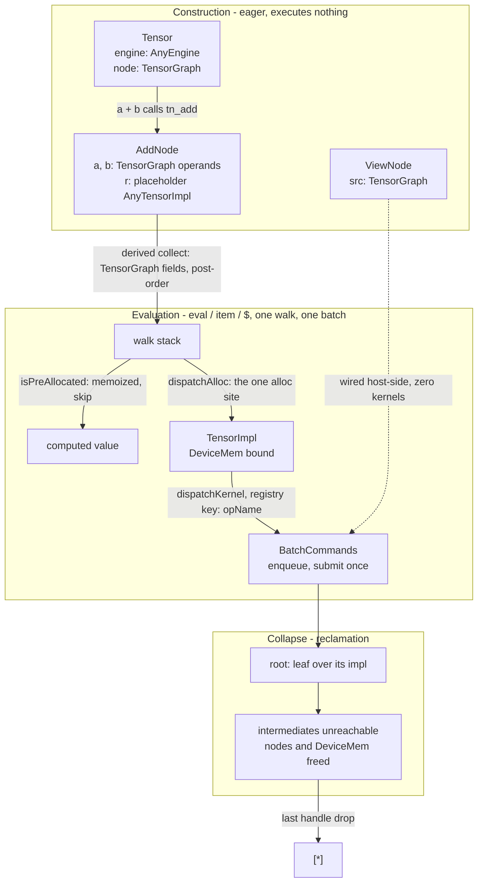

# Tensorcery design

Tensorcery is a tensor library for GPU-first machine learning inference.
It draws from lessons learned from implementing my previous tensor library [Arraymancer](https://github.com/mratsim/Arraymancer), in-particular serialization/deserialization being impossible when the datatype is part of the public static type.
Furthermore, having tuned inference engines like [vLLM](https://github.com/vllm-project/vllm/) and [SGLang](https://github.com/sgl-project/sglang) batching kernel launches is extremely important which is why Tensorcery follows the evaluation model of [MLX](https://github.com/ml-explore/mlx)
(lazy arrays, materialize on read) and operation constructs a graph like MLX or [Dask](https://github.com/dask/dask).

Everything is type-erased at user level — tensors, engines, graph nodes — so any file can
be loaded in any precision mix, and there is no friction to compose anything into higher-level abstractions.

At a low-level there is a dispatch to specialized/monomorphized types where it matters, mostly where tensor-cores are usable.

GPU kernels are generated via Nim macros and the library is being tuned to keep compilation times reasonable, in the 2~20 seconds range.

## Design goals

1. **Tensor is fully type-erased, no generics.** A `Tensor` can load from any
   file, including mixed-precision weights; `T` cannot be generic. Layers
   compose without generics, which means the engine behind them (CUDA,
   OpenCL, Metal, ...) is erased too.
2. **Batch by default.** Launching a kernel is expensive; the framework
   builds a computation graph and submits all in a single batch.
3. **Memoize intermediates.** A result that participates in further
   computation is computed once, ever.
4. **Predictable memory management.** Dropping a handle disables the whole
   graph behind it. The graph must be acyclic so reference counting is deterministic. As a side note, Nim uses destructors and escape analysis to automatically skip reference counting when the compiler can prove that a value doesn't escape its scope.
5. **Portable to many backends**: CUDA, Metal, OpenCL, Vulkan, WebGPU.
6. **Amenable to backward propagation and graph compilation.** The future
   path is `let myCompiledFn = compile(myModel)` with graph coloring for
   allocation planning.
7. **Fast to compile.** Runtime dispatch means all possible kernels a function might be dispatched to get instantiated, nothing can be dead-code eliminated. Tensorcery reduces the monomorphization targets to what makes sense performance-wise. Memory-Bound kernels don't really need per-rank specialization.
8. **Efficient portable tensor-core kernels** via the Ceramic layout algebra
   and tile algebra.
9. **Stride-agnostic kernels.** Views pass their strides to the kernels, so
   no separate `.contiguous()` call is needed before compute. Requiring contiguity costs extra memory allocation and extra bandwidth traffic, and llm inference decode is memory-bandwidth bound.

Derived from those, the evaluation contract:

- **Evaluation is triggered by I/O.** Nothing executes until an explicit
  read (`item`, `eval`, or the planned `$` stringifier). Allocation happens
  inside the same walk, so a graph that is never read never allocates
  device buffers.
- **The framework owns execution.** Operations never launch, allocate, or
  schedule. `evalRoots` is the single execution path; adding an op adds no
  walk code.
- **Collapse reclaims memory.** After evaluation, each root becomes a leaf
  over its computed value and intermediate nodes become unreachable — their
  device memory returns for reuse. VRAM is the scarce resource; the walk
  shortening is a side effect.
- **Rank is capped at 4** in the runtime tier. Higher-rank operations like conv3d would use layout algebra anyway, with a single instantiation.

## Tensorcery vs prior art

| | Tensorcery | Arraymancer | ggml / llama.cpp | JAX | MLX | PyTorch | tinygrad |
|---|---|---|---|---|---|---|---|
| Execution | lazy | eager | full forward-pass graph rebuilt every decode step | eager: each op compiles to a one-op XLA executable on first dispatch (cached per op signature), launched asynchronously; `jit` compiles a whole traced function to one executable | lazy | eager / traced | lazy, graph of UOps (unified ops: one node per elementary operation) |
| Evaluated on | `eval`, `item`, IO | immediately | each decode step: one graph evaluation per generated token | host sync (`block_until_ready`, print, conversion) | `eval`, `item`, `np.array`, print | immediately | when the data is read (`.item()`, `.numpy()`, print) |
| Re-evaluation | memoized, never recomputes | re-evaluates | re-evaluates | re-executes every call; only jit caches (shape/dtype-keyed) | op calls re-execute; array buffers refcounted and cached | re-evaluates | re-evaluates |
| Graph representation | explicit node DAG, persists across evals | autograd tape (a graph, autograd-only) | explicit `ggml_cgraph` per step | jaxpr under jit, lowered to XLA HLO | implicit in array refs (primitive + inputs) | autograd tape (a graph, autograd-only) | the same UOp graph |
| Node identity | erased vtable handle | `Tensor[T]`, `CudaTensor[T]`, `ClTensor[T]` | one struct, runtime type enum, runtime shape | shape and dtype static per value, shape change re-traces | one C++ class, runtime dtype and shape | one erased `Value` per tape node, runtime dtype and shape | one UOp type, runtime dtype and shape |
| Allocation | centralized allocation, one site in the walk | allocator per backend | per-tensor arena | XLA runtime allocator | pooled buffer cache per backend | caching allocator | per-kernel buffers |
| In-place | no design yet | eager assignment | in-place graph ops | immutable; functional `x.at[idx].set()` returns a new array | functional by default; `x[i] += y` desugars to scatter | in-place with aliasing hazards | in-place ops |
| Strides | stride-agnostic kernels, views pass strides, no contiguity copy | strided tensors supported | strides on every tensor, most ops handle them | no strided views, reshape copies | strided slices are lazy, no copy | strided natively, non-contiguous inputs often copy to contiguous | strides in the UOp graph, no copy |
| Rank policy | runtime tier capped at 4, static tier uncapped | arbitrary | MAX_DIMS = 4 | arbitrary; static shapes per trace | arbitrary | arbitrary | arbitrary |
| Backends | CUDA, Metal, OpenCL, Vulkan, WebGPU | CPU, CUDA, OpenCL (compile-time flags) | CANN, CPU, CUDA, HIP, Hexagon, Metal, MUSA, OpenCL, OpenVINO, RPC, SYCL, Vulkan, WebGPU | XLA: CPU, CUDA, oneAPI, ROCm, TPU | CPU, CUDA, Metal | CPU, CUDA, MPS, ROCm, XPU | AMD, CPU, CUDA, Metal, OpenCL, WebGPU |
| Compile path | planned: `compile(model)` with graph coloring | none | none | `jit` (trace to jaxpr, XLA compile, shape-keyed cache) | `mx.compile` (capture, CSE, fusion) | `torch.compile` (Inductor) | BEAM search |
| Autodiff | planned: kernel-level autodiff via Crucible + graph-level autograd | tape (Wengert list), gates with fwd/bwd | none | jvp/vjp tracing, per-primitive rules | vjp walks the forward graph, per-primitive rules | autograd tape | gradients as UOp nodes |

## Key design decisions

### Total type erasure

A `Tensor` is two erased handles: an engine and a graph node.

```Nim
type Tensor* = ref object
  engine: AnyEngine
  node: TensorGraph
```

- `AnyEngine` erases the hardware engine. Layers compose without generics,
  so the same layer code runs against any backend.
- `TensorGraph` is an interface (vtable) over graph nodes. Concretely, a
  node is `ref object of TensorNode` — a real inheritance root, so erased
  round trips are pointer repacks, never boxing.
- Tensor implementations (`TensorImpl[DeviceMem[H, T], LayoutBasic]`)
  themselves implement the node interface. A leaf *is* its impl, erased.

### The graph is a DAG of ref nodes

Every operation builds a node at graph-construction time — eagerly, but
without executing anything. A node holds its operands (`TensorGraph`
fields), its op parameters, and an output placeholder impl
(`engine.newPlaceholderNode`). Because operands are immutable handles, the
structure is a DAG by construction; a cycle would require reading a value
that does not exist yet, and acyclicity is what makes reference-counted
lifetime sound: when the last handle to a subgraph drops, the nodes drop,
and the device buffers behind their impls free.

Views are nodes too — a narrow or squeeze of a computed tensor is a view
node over the same storage, not a copy and not a kernel. The walk wires
view metadata on the host; a view-only graph stages zero kernels.

### The evaluation contract

Nothing executes until a value is read. `item` (and the future `$`, and explicit
`eval`) drive the walk:

- a graph that is never read never allocates device buffers and never
  launches kernels
- once evaluated, a `TensorGraph` node never re-evaluates
- views participate without kernels: their metadata is wired host-side

### Types lifecycle



- Construction builds nodes with placeholder outputs and never touches the device.
- Evaluation pushes operands post-order, allocates each output once, enqueues each kernel once, and submits one batch.
- Collapse replaces roots with newly evaluated leaves and frees the orphaned ancestor nodes.

### The walk: collect, mark, allocate, enqueue

`evalRoots` is the single execution path, two visits per node:

1. **First visit — collect.** Operands are pushed post-order so a kernel
   enqueues only after its inputs. Collection is *derived*: the framework
   walks the node's `TensorGraph`-typed fields; an operation writes no
   collect code. Already-allocated nodes are skipped (the memoization
   check, and within-eval diamond dedup).
2. **Second visit — allocate, enqueue.** The output impl is allocated
   through the engine (`dispatchAlloc`) — the single allocation site in
   the codebase — then the op's kernel handler builds bridge arguments
   from erased metadata and enqueues into the batch. The batch is
   submitted once, after the walk.

Dispatch is a registry keyed by each node type's static `opName`, filtered
by compile-time marks (`hasKernel: "Add"` on the public proc increments a
per-op counter at every expansion; the dispatch reads those counters). The
dtype `case` lives in small templates around one dispatch macro.

Post-order allocation falls out of the existing stack. Lifetimes are not
stack-ordered: dropping an ancestor frees its buffer while descendants
still live. The planned `compile(model)` coloring pass computes buffer
intervals from the graph instead of assuming a stack.

### Collapse: reclamation as a graph operation

After the batch submits, every root is replaced by a leaf over its
computed impl:

```Nim
# Graph collapse: roots become leaves over their computed impls,
# later evals walk nothing upstream.
```

Three consequences, in order of importance:

1. **Intermediate memory is reclaimed.** Nodes no longer reachable from
   any live handle drop, and their device buffers free. In a decoding
   loop this is the difference between constant VRAM and unbounded growth.
2. **Memoization becomes structural.** A leaf *is* the value; the
   compute-once property no longer depends on a marker bit surviving.
3. **Later walks are O(new nodes).** The next eval stops at the first
   leaf instead of traversing history.

Tensors built after an evaluation capture the collapsed leaf; references
captured before keep the original nodes and still skip correctly via the
allocation check. Both are tested (`t_graph_collapse_metal`).

The rejected alternative: marker-only memoization (keep the full graph
alive forever, rely on the allocated check to skip). It dedups correctly
but pins every intermediate until the handle drops — with VRAM as the
budget, that is the wrong trade.

### View offsets: op-record state, materialized on demand

A view's offset is relative to its source. An impl's `offset` is a position
inside its backing allocation. Two fields hold the two values:

- the relative offset is op-record state: `ViewNode.viewOffset`, stored at
  construction, never folded into the impl.
- the impl's `offset` is alloc-position only: 0 until the walk materializes
  the view (`enqueueView` assigns the derived value, idempotent, never
  accumulated), rewritten once when evaluation replaces the root by its
  computed leaf.
- materialization is derived on demand by `getMaterializedOffset`: walk the
  view chain summing relative offsets, add the first non-view impl's offset.
  The derivation is pure and never cached: an offset becomes *materialized*
  when fused into the backing allocation, never "absolute".

A view's impl is unallocated until the walk reaches it, so the existing
dedup skip does the once-only job for free: a pre-visit view has no data
and is materialized, a post-visit view has data and is skipped. The
post-order visit materializes a view before any consumer's kernel enqueues,
which is why kernel writers read plain `impl.offset` and never see a view.

Evaluation replaces an evaluated root by a computed leaf and frees the
root's ancestors, so the source chain of a view over an already-evaluated
view is gone. Such a view bounds its window against the backing buffer's
size, not the logical size: the replacement leaf's logical size is the
view's window, while its buffer is the original root's. The buffer size is
recorded on the impl (`bufferSize`) at the allocation sites and travels
with every data rebind. Bounding materialized coordinates against a logical
size mixes coordinate spaces.

The op record is the future autodiff tape entry: it carries its own
parameters (shape, strides, `viewOffset`) and its parent link. Backward of
a view scatters the child's gradient through the relative window and never
touches allocation addresses, which is why materialization stays
derive-on-demand.

### Memory management

Allocation is engine-owned and centralized: operations never allocate,
the walk does, at exactly one site, in post-order. Device memory
(`DeviceMem[H, T]`) is non-GC; it frees when the impl holding it drops.
Combined with the collapse, the memory story is:

- buffers live exactly as long as the values they back;
- lifetimes follow handle drops: an ancestor can free before its
  descendants;
- dropping a handle is the only way memory returns — no GC pauses, no
  finalizer ordering surprises.

### Layout tiers: runtime erasure up to the kernel boundary

The runtime tier (`LayoutBasic`) carries rank, shape, and strides as
runtime metadata, capped at `MaxRank = 4` — the cap is a falsifiable
build-time error, not a comment. The static tier (`Layout`, Ceramic's
layout algebra) is uncapped and compile-time, used at the kernel boundary
where tiles and tensor-core fragments need static structure.

The bridge between them (`relayoutBridge`) rebuilds static-rank arguments
from runtime metadata at dispatch; nothing moves, no ranked impl
materializes. Operations that genuinely need rank 5+ (a conv3d
hypothetical) would live behind a static-typed boundary, not in the
runtime tier. Video follows llama.cpp's ruling: time rides the batch
dimension, temporal merging is a reshape/permute away.

### Ceramic: the kernel layer

Kernels are Ceramic tile programs: a kernel is written over tiles and
layouts, and the backend lowers it (MSL, GLSL, WGSL, CUDA-C++). The add
kernel is the canonical shape — grid-stride over tiles, fp16/bf16
promoted to fp32 for arithmetic where the backend lacks native half
support. Tensor-core GEMMs come from the same algebra; subgroup-size
assumptions are falsified on real hardware (Metal 32, Intel iGPU 8,
AMD wave32/64) rather than asserted.

### Backends

All backends hang off the erased engine interface; the kernel layer is
shared, only the bridge differs.

| Backend | State |
|---|---|
| Metal (MSL) | first-class, in daily rotation |
| Vulkan (GLSL via glslang) | working; subgroup-size assumptions must be falsified (MoltenVK, lavapipe) |
| OpenCL | compiles and launches |
| WebGPU (WGSL) | blocked on a pre-existing device-layer bug, queue known |
| CUDA (CUDA-C++ via NVRTC) | workstation-only today; AOT + ship-binary ruling |

The intent is to bring all of them to green; the status table is kept
honest rather than aspirational.

### The future: compile(model) and autodiff

`let myCompiledFn = compile(myModel)` is the planned compilation path:
capture the graph, color it for allocation, emit a fused artifact per
backend. Much of the machinery exists — the batch layer already emits
whole-graph artifacts, post-order allocation already assigns buffers in a
deterministic order, and the registry already separates op semantics from dispatch.

Autodiff is planned as a two-level combination: kernel-level autodiff in
Crucible (mratsim/tattletale#171, making any Nim kernel code
differentiable) combined with graph-level autograd over the node DAG. Nodes are materialized
objects (not traced closures), so the graph-level pass can be another
graph transformation over the same DAG, and the derived-collect pattern
(walk the fields) extends to deriving gradients from the same node
definitions.

## How to add a new operation

The dispatch instantiates one branch per operation that the compilation
has already used at the expansion point of `eval`/`item`/`allClose`.
A helper proc wrapping those, defined before any operation is used (or in
a library module compiled before user code), snapshots an empty op set
and raises `no handler` at runtime. Define such helpers after the first
operation use in the same module, or after the imports that use them.

The complete recipe, using add. An operation is one module with five
pieces, a registration line, and tests; the framework supplies collect,
dedup, allocation, batching, and dispatch.

**1. The kernel** — a Ceramic tile program over views:

```Nim
proc k_add(D, A, B: distinct TensorBasicView) =
  let thrID = getLocalThreadID()
  var reg: tile(D.T)
  let tiled = make_layout(D.size()).logical_divide(reg.getLayout())
  let grid = tiled.getTileGrid()
  let (cSize, gridStride) = (grid.size(), getGridSize())
  for tileID in countup(grid.getLocalTileID(), cSize - 1, gridStride):
    let rA = tile(A.T).load(A, thrID, tileID)
    let rB = tile(B.T).load(B, thrID, tileID)
    var rD: tile(D.T)
    for i in 0 ..< rA.size():
      when typeof(rA[i]) is (bfloat16|float16) and ccGetBackend() != ctCuda:
        rD[i] = (rA[i].to(float32) + rB[i].to(float32)).to(typeof(rA[i]))
      else:
        rD[i] = rA[i] + rB[i]
    D.store(rD, thrID, tileID)
```

**2. The node** — operands as `TensorGraph` fields, output as an impl
field; the framework's derived collect walks exactly these:

```Nim
type AddNode* = ref object of TensorNode
  r: AnyTensorImpl
  a, b: TensorGraph
```

**3. The node interface** — the output getter and the static name that
becomes the registry key (written once, nowhere else):

```Nim
func getImpl*(n: AddNode): AnyTensorImpl {.inline.} = n.r
func opName*(_: typedesc[AddNode]): static string = "Add"
```

**4. The graph constructor and the kernel handler.** The constructor
builds the node eagerly with a placeholder output — no execution. The
handler casts the erased pieces to their concrete impls and enqueues; it
returns `false` when the node is not its node type (the registry filters
by name first, the check is belt-and-braces):

```Nim
proc tn_add*(engine: AnyEngine, a, b: TensorGraph): TensorGraph {.contracts.} =
  let ia = a.getImpl()
  let ib = b.getImpl()
  {.precondition: ia.shape().p == ib.shape().p.}
  {.precondition: ia.dtype() == ib.dtype().}
  return AddNode(a: a, b: b,
      r: engine.newPlaceholderNode(ia.dtype(), ia.shape().p).getImpl()).to(TensorGraph)

proc enqueueAdd[E: HwEngine, T](engine: E, batch: BatchCommands[E], n: var TensorGraph, _: typedesc[T]): bool =
  let asAdd = n.to(AddNode)
  if asAdd.isNil():
    return false
  let
    rImpl = asAdd.r.to(engine.getTensorImplType(T))
    aImpl = asAdd.a.getImpl().to(engine.getTensorImplType(T))
    bImpl = asAdd.b.getImpl().to(engine.getTensorImplType(T))
    size = rImpl.size()
  batch.enqueue<<(ceil_div(size, Fleet.elemsPerGroup), LaneWidth)>> k_add(rImpl.bridge(), aImpl.bridge(), bImpl.bridge())
  return true
```

**5. Registration and the public proc.** `registerOp` binds the node type
to its kernel under the static name; the public proc is marked with the
same name so every call site records a dispatch mark:

```Nim
registerOp(AddNode, enqueueAdd, opName(AddNode))

proc `+`*(a, b: Tensor): Tensor {.inline, hasKernel: "Add".} =
  Tensor(engine: a.engine, node: tn_add(a.engine, a.node, b.node))
```

**6. Tests** — a backend-agnostic template plus one entry file per backend.
The template, `ops_add_template.nim`, is written once: it seeds a host RNG,
builds reference data, drives the public API, and checks with `allClose`,
the framework's comparison op, so the test exercises the same graph
machinery it verifies (bfloat16 references promote through float32). The
runtime is a static parameter, so the template monomorphizes per backend
and the same checks run everywhere. A backend entry file is the whole story:

```Nim
import ./ops_add_template

proc main =
  runAddTest(runMetal, "Metal")

when isMainModule:
  main()
```

The same pattern ships `t_ops_2i1o_opencl.nim`, `t_ops_2i1o_vulkan.nim`,
and `t_ops_2i1o_webgpu.nim`; a new operation adds its template and one
entry file per backend under test.

What an operation does **not** write: collect logic (derived from the node
fields), allocation (the walk allocates the placeholder), batching (the
walk submits), dedup (the allocated check), and dispatch plumbing (the
registry entry is the one line).

Two naming rules keep the registry honest: the op name exists exactly
once (`opName`, reused by both `registerOp` and `hasKernel` — a mismatch
presents as a baffling "no handler" at runtime), and the name is an
identity, not a description: `Add`, `Rmsnorm`, `Gemm`.
